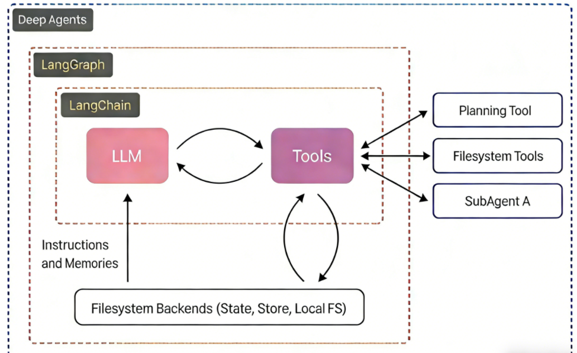

# 项目背景
「深度研搜（DeepAgents 多智能体）」是一个面向复杂研究任务的企业级智能体实战项目。它最终要做的不是简单问答，而是让智能体围绕一个开放问题进行资料搜索、信息整理、反思补充和报告生成。

如果把后续项目目标说得更具体一点，可以理解为一个「深度研搜」系统：

用户提出一个研究问题；
系统自动拆解研究方向；
不同工具或子智能体分别完成搜索、阅读、分析、校验等任务；
主智能体汇总中间结果，生成一份结构完整的研究报告。

## 为什么需要deepagent

### 已有方法 

直接调用大模型接口，让模型返回文本；
使用 LangChain 封装模型、提示词、输出解析器和工具；
使用 LangGraph 把复杂任务拆成多个固定节点；
使用 Agent 让模型在执行过程中自主决定是否调用工具。、

### 会有的问题 

上下文越来越乱，工具返回结果和历史消息容易挤在一起；
任务拆解不稳定，模型可能想到哪做到哪；
所有事情都压在一个主智能体身上，专业分工不清晰；
中间过程难以观察，出错时不好定位；
多轮搜索、多轮反思、多方向并行时，执行链路容易失控

## 实际流程

用户任务
  -> 主智能体负责规划和调度
  -> 调用工具或分派给子智能体
  -> 子智能体独立完成局部任务
  -> 主智能体汇总并输出最终结果
  
## deepagent在体系中的位置 

DeepAgents 是 LangChain 生态中的一个独立库，建立在 LangChain 和 LangGraph 的基础能力之上，用来构建更复杂的自主多智能体系统。

最内层是 LangChain，负责大模型与工具之间的基本交互；
中间层是 LangGraph，负责把执行过程组织成有状态、可持久化、可流式输出的图；
最外层是 DeepAgents，进一步提供规划工具、文件系统工具、子智能体和后端存储能力。

| 框架 | 核心定位 | 更适合什么时候使用 |
| --- | --- | --- |
| LangChain | 基础开发框架，封装模型、Prompt、工具、Agent 等能力 | 快速构建简单 Agent，或者自己组合模型与工具 |
| LangGraph | 图执行框架，强调状态、节点、边、分支、持久化和流式输出 | 流程明确、需要细粒度控制、需要稳定编排的复杂工作流 |
| DeepAgents | 深度智能体框架，强调自主规划、子智能体、上下文管理和长期记忆 | 长任务、多步骤、多角色、需要智能体自己规划和调度的任务 |